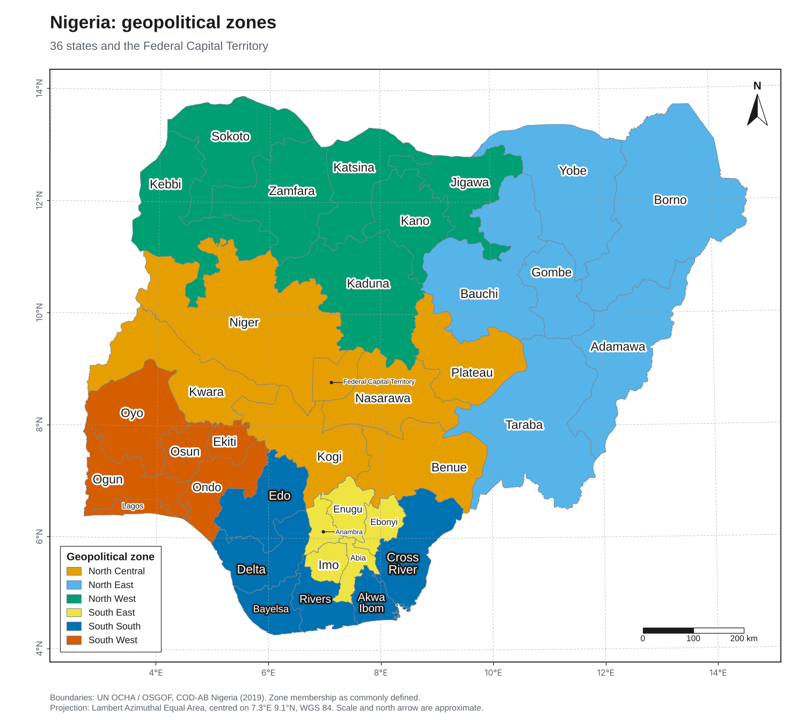
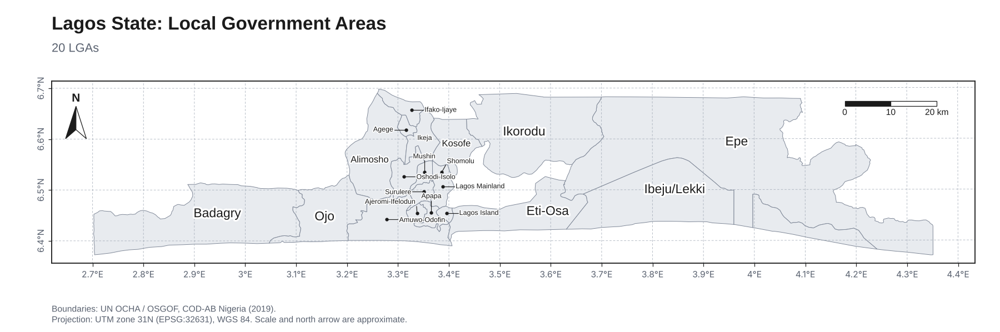
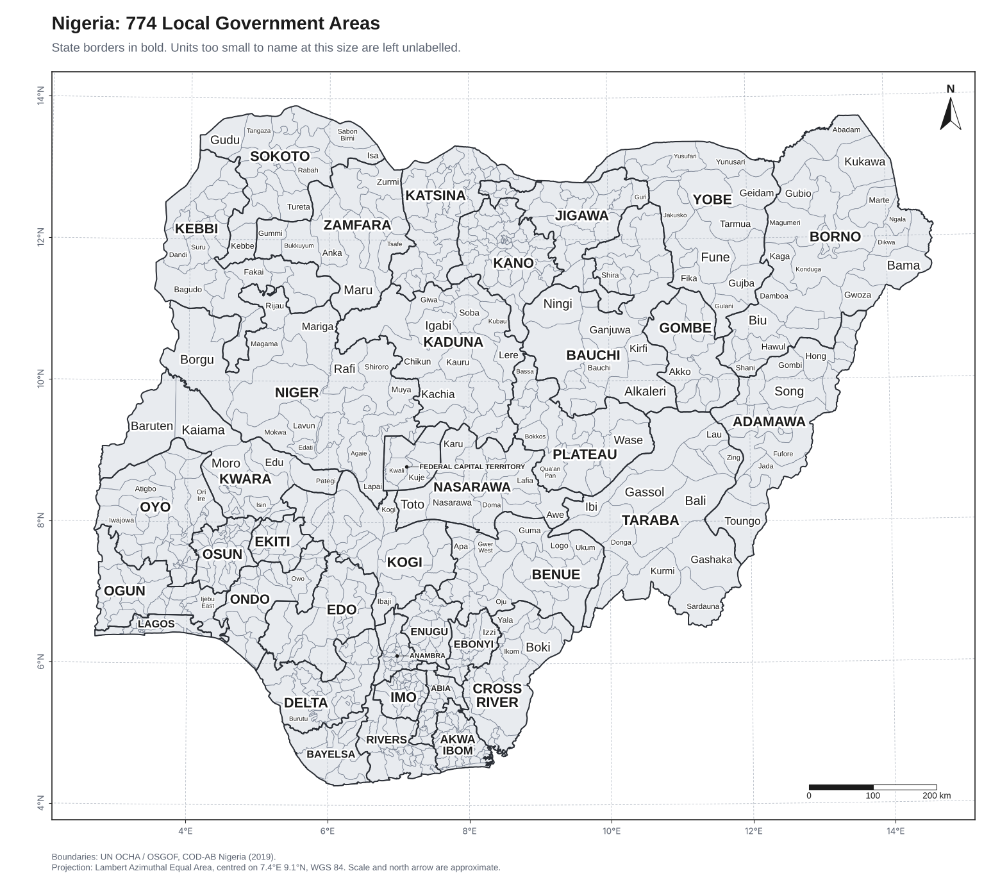

# MosesLukeGISmapdeveloper

**Clean, labelled, publication-ready maps from raw GIS data.** Upload a zipped shapefile, GeoJSON, GeoPackage or KML and get a finished map: areas coloured by your numbers, names that do not overlap, a legend, scale bar, north arrow and grid labels.

[](https://github.com/Moses-L/geomapclean/actions/workflows/ci.yml)

**Use it online, nothing to install: https://moseslukegismap.streamlit.app/**



Built by Moses Luke for researchers, epidemiologists and programme teams who have boundary files and numbers but do not want to spend an afternoon in desktop GIS software to get a tidy figure. The Python package is called `moseslukegeomap` and the command is `geomapclean`.

## Contents

1. [Try it in two minutes](#1-try-it-in-two-minutes)
2. [Install](#2-install)
3. [Prepare your data](#3-prepare-your-data)
4. [Walkthrough: the web app](#4-walkthrough-the-web-app)
5. [Walkthrough: a worked example with real boundaries](#5-walkthrough-a-worked-example-with-real-boundaries)
6. [Command line reference](#6-command-line-reference)
7. [Python reference](#7-python-reference)
8. [How it works](#8-how-it-works)
9. [Troubleshooting](#9-troubleshooting)
10. [Limits](#10-limits)
11. [Hosting a public copy](#11-hosting-a-public-copy)
12. [Development, citing and licence](#12-development-citing-and-licence)

## 1. Try it in two minutes

**Quickest:** open the live app at https://moseslukegismap.streamlit.app/, switch on the demo in the sidebar, then upload your own file. Nothing is installed.

**On your own computer** (needed for confidential data): you need Python 3.10 or newer. In a terminal (PowerShell on Windows):

```bash
pip install "moseslukegeomap[app]"
geomapclean app
```

Your browser opens the app. Switch on **Use the built-in demo** in the left sidebar. You will see a map of an invented island with named districts coloured by a made-up coverage figure. Nothing real is shown, so you can click around safely. Then upload your own file.

Prefer no app? This writes the same demo map to a file:

```bash
pip install moseslukegeomap
geomapclean demo -o demo.png
```

## 2. Install

| Step | Windows | Mac and Linux |
|---|---|---|
| 1. Get Python 3.10 or newer | Download from python.org. On the first installer screen, tick **Add python.exe to PATH**. | Usually installed already. Check with `python3 --version`. |
| 2. Open a terminal | Press the Windows key, type PowerShell, press Enter. | Open Terminal. |
| 3. Install | `pip install "moseslukegeomap[app]"` | `pip3 install "moseslukegeomap[app]"` |
| 4. Check | `geomapclean --version` | `geomapclean --version` |

Leave out `[app]` if you only want the command line and Python library. No other software is needed. There is no separate GIS installation.

If `pip` is not recognised, Python is not on your PATH. Reinstall Python with the PATH box ticked, then open a new terminal window.

## 3. Prepare your data

**Boundary file.** One of these:

| You have | Upload |
|---|---|
| Shapefile | Zip the whole set into one `.zip`. It needs `.shp`, `.shx` and `.dbf`. Include `.prj` so the projection is known. Do not rename the files separately. |
| GeoJSON, GeoPackage, KML | The file as it is. |
| A zip holding several layers | Fine. The app lists them and you pick one. |

Each row of the boundary file should be one area, with a column of names such as `District` or `ADM2_EN`.

**Numbers to show (optional).** A CSV or Excel file with one row per area and a column with the area name:

| district | coverage_pct |
|---|---|
| Northvale | 81.2 |
| Eastmoor | 64.5 |
| Saltmarsh | 72.0 |

The names do not have to match exactly. Capital letters, extra spaces and different dash characters are ignored. Spelling differences are reported with a suggested match.

## 4. Walkthrough: the web app

Start it with `geomapclean app`. The page has four tabs: **Make a map**, **How to use it**, **How it works** and **About**. All controls are in the left sidebar.

### Step 1: Upload your data

Drop your zip, GeoJSON, GeoPackage or KML into the upload box. If you have loose shapefile parts instead of a zip, select all of them together.

If the file holds several layers, a list appears. Choose the layer you want to map. A second list lets you pick a polygon layer to draw as bold outlines on top, for example state borders over district boundaries.

### Step 2: Focus on part of the map (optional)

Choose a column and one or more values, for example `ADM1_EN` is `Lagos`. Only those areas are mapped. This is the best way to get every name onto a map that has many small areas.

### Step 3: Attach your numbers (optional)

Upload your CSV or Excel file. Then choose which map column and which table column hold the area names. The report beside the map tells you how many areas matched, which did not, and what the closest spelling might be.

### Step 4: Choose the style

| Setting | What it does |
|---|---|
| Title, subtitle, source line | Printed on the map. Always fill in the source line. |
| Colour areas by | The column that sets the colours. Leave as none for a plain base map. |
| Method | How to group numbers: quantiles, equal interval, natural breaks (jenks) or categorical. See the table below. |
| Classes | Number of colour groups, from 2 to 9. Five is a good default. |
| Colours | The colour scale. Use a diverging scale such as RdBu only when your data has a meaningful middle. |
| Legend title | Say what the numbers are and the unit, for example "Coverage (%)". |
| Label with | Which column supplies the names. The app picks one automatically. Choose "(no labels)" to switch labels off. |
| Label case | Keep as is, Title Case or UPPER CASE. |
| Small areas | Automatic, label with a leader line, or leave unlabelled. |
| Theme | Light, paper or dark. |
| Figure width | Wider figures fit more names. Use 20 or more for a poster. |
| Show | Switch the legend, scale bar, north arrow and graticule on or off. |

### Choosing how to group numbers

| Method | Use it when | What it does |
|---|---|---|
| Quantiles | You want to compare areas by rank, such as top fifth against bottom fifth. | Puts the same number of areas in each group. |
| Equal interval | Values are fairly evenly spread and you want a plain scale. | Splits the range into equal steps. |
| Natural breaks (jenks) | Values form clusters. | Cuts where the data has gaps. |
| Categorical | The column holds categories such as zone or type. | One colour per category. |
| Manual (command line and Python) | You need set cut-offs such as 50, 80 and 95 per cent. | Uses the breaks you give. |

Different methods can tell different stories from the same data. State the method in your figure caption.

### Step 5: Read the report

The panel next to the map shows features mapped, the projection used, labels placed and skipped, and any join problems. Read it before you export. A warning that areas are shown as "No data" almost always means a spelling mismatch in your table.

### Step 6: Download

Switch on **Prepare high-resolution files**. You get a PNG at 300 dpi for documents and slides, an SVG you can edit in Inkscape or Illustrator, and a PDF for journals.

## 5. Walkthrough: a worked example with real boundaries

This example uses national boundaries for Nigeria from the UN OCHA Common Operational Datasets (COD-AB). Download the Nigeria administrative boundaries from the Humanitarian Data Exchange and check the terms of use there. The zip holds layers for the country, 37 states, 774 LGAs and more.

**Goal:** a map of the six geopolitical zones, then a map of every LGA in Lagos State.

### Map 1: zones, using a table

The file `examples/nigeria_geopolitical_zones.csv` lists each state and its zone.

```bash
geomapclean inspect nga_boundaries.zip
```

This lists every layer with its feature count and columns. The state layer is `nga_admbnda_adm1_osgof_20190417.shp` and its name column is `ADM1_EN`.

```bash
geomapclean draw nga_boundaries.zip \
  --layer nga_admbnda_adm1_osgof_20190417.shp \
  --join examples/nigeria_geopolitical_zones.csv --join-key ADM1_EN=state \
  --color-by geopolitical_zone --classification categorical \
  --legend-title "Geopolitical zone" \
  --title "Nigeria: geopolitical zones" \
  --source "Boundaries: UN OCHA / OSGOF, COD-AB Nigeria (2019)." \
  --label-case title -o zones.png
```

The command prints `join: 37 of 37 map areas matched`, which confirms every state found its zone. The result is the map at the top of this page. (On Windows PowerShell, put the command on one line or end each line with a backtick instead of a backslash.)

### Map 2: every LGA in one state

Mapping all 774 LGAs at once leaves most names off, because they cannot fit. Focus on one state instead:

```bash
geomapclean draw nga_boundaries.zip --layer nga_admbnda_adm2_osgof_20190417.shp \
  --where ADM1_EN=Lagos --title "Lagos State: Local Government Areas" \
  --width 12 -o lagos.png
```



All 20 names appear. The central, crowded LGAs get a short leader line so their names stay readable. Because the Lagos extent is wide and short, the projection and the page shape were chosen for you.

### Map 3: the whole country with state outlines

```bash
geomapclean draw nga_boundaries.zip --layer nga_admbnda_adm2_osgof_20190417.shp \
  --overlay-layer nga_admbnda_adm1_osgof_20190417.shp \
  --title "Nigeria: 774 Local Government Areas" --width 12 -o nigeria_lgas.png
```



State names are drawn in bold capitals, and LGA names appear wherever they fit without crowding. The command tells you how many were left out and how to name more of them.

## 6. Command line reference

```text
geomapclean inspect FILE                     list layers, feature counts and columns
geomapclean draw FILE -o OUTPUT [options]    draw a map
geomapclean demo -o demo.png                 draw the built-in demo
geomapclean app [streamlit options]          start the web app
```

`FILE` can be a zip, a folder, a `.shp`, `.geojson`, `.gpkg` or `.kml`. The output format comes from the file ending: `.png`, `.svg`, `.pdf`, `.jpg` or `.tif`.

| Option | Meaning |
|---|---|
| `--layer NAME` | Layer to draw when the file has several. Use the names printed by `inspect`. |
| `--overlay-layer NAME` | Polygon layer drawn as bold outlines on top. |
| `--where COL=VAL[,VAL]` | Keep only matching rows, for example `ADM1_EN=Lagos,Ogun`. |
| `--join FILE --join-key MAPCOL=TABLECOL` | Attach a CSV or Excel table by area name. |
| `--title`, `--subtitle`, `--source` | Text on the map. |
| `--color-by COL` | Column that sets the colours. |
| `--classification` | `auto`, `quantiles`, `equal`, `jenks`, `manual` or `categorical`. |
| `-k N` | Number of classes. |
| `--bins 10,20,50` | Break values for manual classification. |
| `--cmap NAME`, `--reverse-cmap` | Matplotlib colour scale, for example `Blues`, `viridis`, `RdBu`. |
| `--legend-title`, `--legend-loc` | Legend text, and corner (`upper left`, `lower right` and so on). |
| `--decimals N` | Decimal places in legend ranges. |
| `--label-column COL` | Column for names. Default picks one automatically. |
| `--label-case` | `as-is`, `title` or `upper`. |
| `--overflow` / `--no-overflow` | Force leader-line labels for small areas on or off. |
| `--label-max N` | Label at most N areas, largest first. |
| `--no-labels`, `--no-legend`, `--no-scale-bar`, `--no-north-arrow`, `--no-graticule`, `--no-frame`, `--no-crs-note` | Switch parts off. |
| `--theme` | `light`, `paper` or `dark`. |
| `--font NAME` | Preferred font. Falls back if it is not installed. |
| `--width INCHES` | Figure width. Default 10. |
| `--dpi N` | Resolution for PNG, JPG and TIF. Default 300. |
| `--crs auto\|EPSG` | Projection. `auto` chooses one. Give a code such as `32632` to force it. |
| `--assume-crs EPSG` | Projection to assume when the file has none. |
| `--credit` | Add a small "made with" line. |

## 7. Python reference

```python
import geopandas as gpd
from moseslukegeomap import make_map, MapOptions, join_table, read_table

states = gpd.read_file("states.shp")
table = read_table("coverage.csv")
states, report = join_table(states, table, left_on="STATE", right_on="state")
print(report["unmatched_in_map"], report["suggestions"])      # check the join

result = make_map(
    states,
    MapOptions(title="Coverage by state", color_by="coverage", k=5,
               legend_title="Coverage (%)", source="Source: programme data, 2026"),
)
result.save("coverage.png", dpi=300)       # also .svg, .pdf, .jpg, .tif
print(result.report)                       # labels placed and skipped, projection, notes
```

`make_map(layer, options=None, overlay=None, **overrides)` returns a result with `.save(path, dpi)`, `.to_bytes(format, dpi)` and `.report`. Any option can also be passed directly, for example `make_map(states, title="X", theme="dark")`.

| `MapOptions` field | Default | Meaning |
|---|---|---|
| `title`, `subtitle`, `source` | none | Text printed on the map. |
| `labels` | `True` | Draw names. |
| `label_column` | `"auto"` | Name column. |
| `label_case` | `"as-is"` | `"as-is"`, `"title"` or `"upper"`. |
| `label_font_max`, `label_font_min` | 11, 5.5 | Text size range in points. |
| `label_overflow` | `None` | `None` is automatic, `True` uses leader lines, `False` leaves small areas blank. |
| `label_max` | none | Cap on the number of labels. |
| `color_by` | none | Column that sets the colours. |
| `classification` | `"auto"` | `quantiles`, `equal`, `jenks`, `manual`, `categorical`. |
| `k`, `bins` | 5, none | Class count, or manual breaks. |
| `cmap`, `reverse_cmap` | `YlOrRd`, `False` | Colour scale. |
| `legend`, `legend_title`, `legend_loc`, `decimals` | on, column name, `"auto"`, auto | Legend settings. |
| `north_arrow`, `scale_bar`, `graticule`, `frame`, `crs_note` | all `True` | Map furniture. |
| `theme`, `font`, `width_in` | `"light"`, auto, 10 | Look and size. |
| `point_size`, `line_width` | 5, 1 | For point and line layers. |
| `crs`, `assume_crs` | `"auto"`, none | Projection handling. |
| `credit` | `False` | Small "made with" line. |

Errors that you can fix (wrong column, missing projection, unreadable file) raise `moseslukegeomap.DataError` with a plain message.

## 8. How it works

Every upload goes through the same stages. Your original file is never changed.

| Stage | What happens |
|---|---|
| Read | Zipped shapefiles, loose parts, GeoJSON, GeoPackage and KML are opened. Unzipping refuses unsafe paths. |
| Clean | Empty features are dropped, 3D is flattened, invalid polygons are repaired, the dominant geometry type is kept. A missing projection is assumed to be WGS 84 only if the numbers look like longitude and latitude. Otherwise the tool stops and asks. |
| Project | A small area gets a UTM zone. A country or region gets a Lambert azimuthal equal-area projection centred on the data. A world map gets Equal Earth. The choice is printed under the map. |
| Colour | Values are grouped into classes. Categories use a colour-blind-safe palette. Missing values get a "No data" class. |
| Lay out | Legend, scale bar and north arrow are placed in the emptiest corners. Margin is added if no corner is clear. |
| Label | Names are placed largest area first. See below. |
| Export | One layout is written as PNG, SVG, PDF, JPG or TIFF. Text is placed in points, so the layout is identical at any resolution. |

### How the names are placed

1. Each name is measured in the chosen font.
2. For each area, the tool finds the point furthest from its edges.
3. It tries the largest text size that fits inside the area, down to a minimum. Long names can split onto two lines.
4. The name is kept only if it touches no earlier name, the legend, the scale bar or the north arrow.
5. Text is white with a dark outline on dark fills, and dark with a white outline on light fills.
6. Areas that are too small are left blank, or, if allowed, named beside the area with a thin leader line that avoids other text.

The test suite checks that no two pieces of text overlap, and the same check was run on every layer of a national boundary dataset during development.

## 9. Troubleshooting

| What you see | Likely cause and fix |
|---|---|
| `pip` or `geomapclean` is not recognised | Python is not on your PATH. Reinstall Python with **Add python.exe to PATH** ticked and open a new terminal. |
| "No map data found" | The zip has no `.shp`, `.geojson`, `.gpkg` or `.kml` inside, or it is damaged. |
| "has no .dbf file" | The shapefile set is incomplete. Zip all parts together. |
| "The file has no coordinate system" | `.prj` is missing and the numbers are not longitude and latitude. Add the `.prj`, or pass `--assume-crs` with the EPSG code (in Python, `assume_crs=`). |
| "This upload holds several layers" | Choose one with `--layer`. Run `geomapclean inspect FILE` to see the names. |
| Areas show as "No data" | Their names did not match your table. Read the `join:` lines in the report, fix the spelling, and run again. |
| "repeated keys" | Two rows in your table have the same area name once case and spaces are ignored. Each area needs one row. |
| "too many for a categorical map" | The column has more than 20 different values. Use a numeric method, or group the categories first. |
| "is not numeric" | You asked for ranges on a text column. Use categorical, or clean the numbers in your table. |
| No labels drawn | No name column was found. Pass `--label-column` with the right column. |
| Many names missing | The areas are too small at this size. Use `--where` to map one region, raise `--width`, or add `--overflow`. |
| Text looks different on another computer | The preferred font was not installed and a fallback was used. Set `--font` to a font you have. |

## 10. Limits

- Scale bar and north arrow are approximate. They are accurate near the map centre and drift slightly at the edges.
- Very large layers (over about 600,000 vertices) are lightly simplified for drawing, with no visible change at map scale.
- One thematic layer is drawn, with an optional outline layer on top. There are no basemap tiles, satellite images, rasters or inset maps. Use QGIS when you need those.
- It cannot name every area on a very dense map at a normal page size. It reports how many it left out.
- It does not check whether your boundaries are correct or current.

## 11. Hosting a public copy

A public copy of this app runs at https://moseslukegismap.streamlit.app/. To host your own, the repository contains `streamlit_app.py` and `requirements.txt`, which is what Streamlit Community Cloud needs.

1. Sign in at share.streamlit.io with your GitHub account.
2. Choose **Create app**, select the repository `Moses-L/geomapclean`, branch `main`, and main file `streamlit_app.py`.
3. Deploy. The first build takes a few minutes.

The app processes uploads in memory and does not store them. Even so, tell users not to upload sensitive or identifiable data to a shared public server. For confidential data, each person should run the app on their own computer.

## 12. Development, citing and licence

```bash
git clone https://github.com/Moses-L/geomapclean
cd geomapclean
pip install -e ".[dev]"
pytest
```

**Boundary data.** The package ships only a small invented demo layer ("Null Island"). The example maps use the UN OCHA / OSGOF Nigeria boundaries (COD-AB, 2019). Check the publisher's terms for any boundary data you use, and credit it on your map.

**Citing.** Use the "Cite this repository" button on GitHub, or the DOI on the release page once it is archived on Zenodo. Suggested wording for methods sections: "Maps were produced with MosesLukeGISmapdeveloper (geomapclean), Luke M."

**Licence.** MIT. See `LICENSE`.

**Author.** Moses Luke. GitHub: [Moses-L](https://github.com/Moses-L). ORCID: [0000-0002-0600-6660](https://orcid.org/0000-0002-0600-6660).
